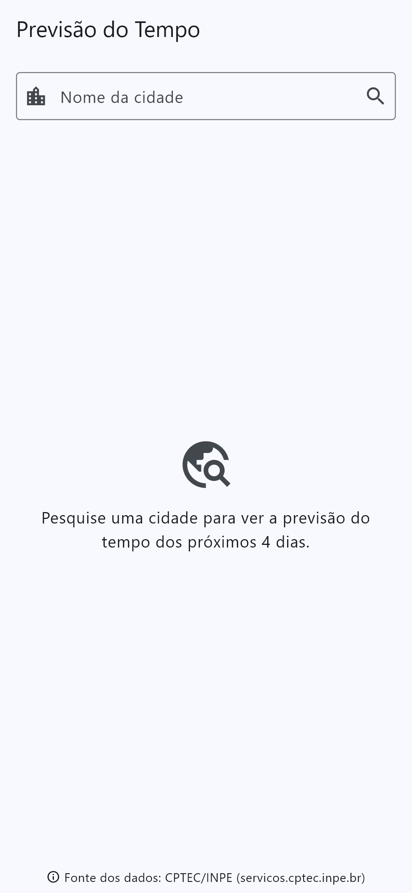
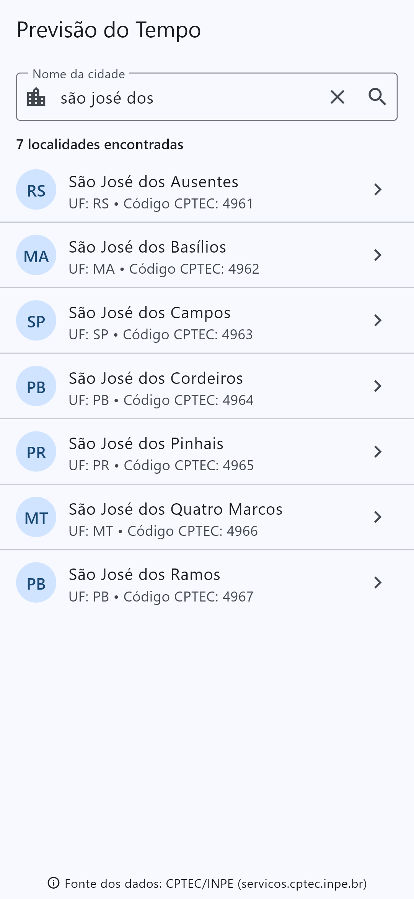
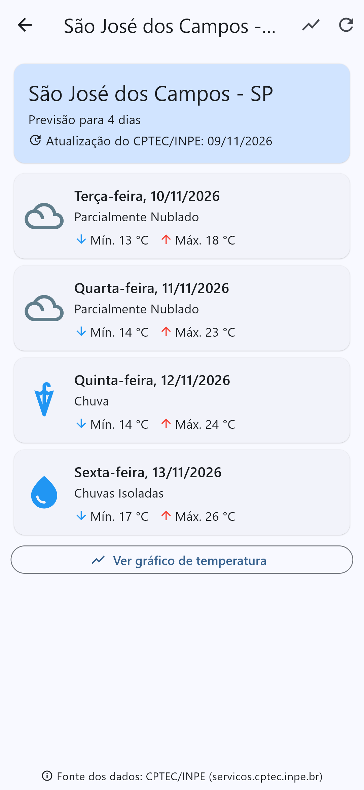
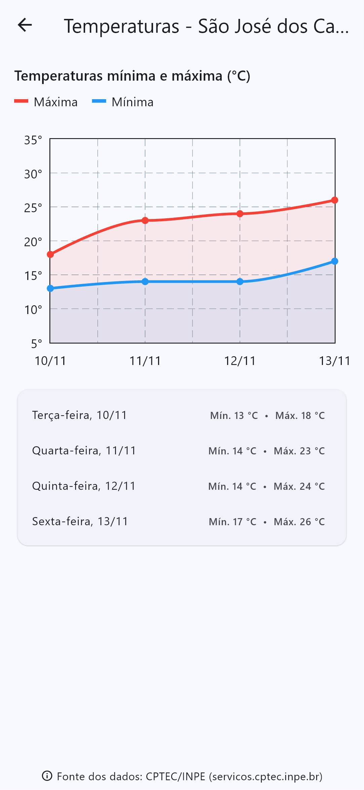
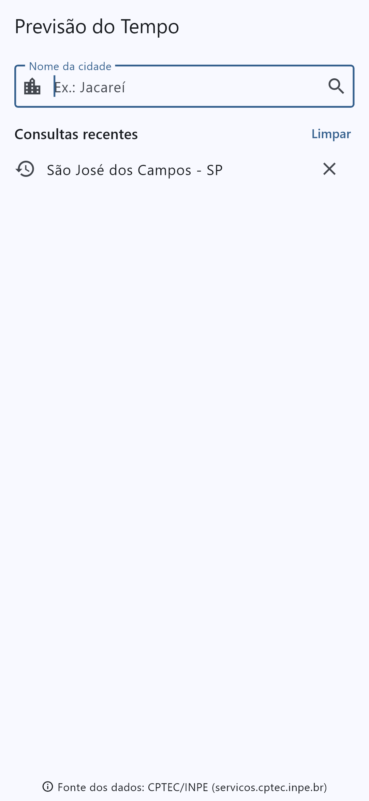
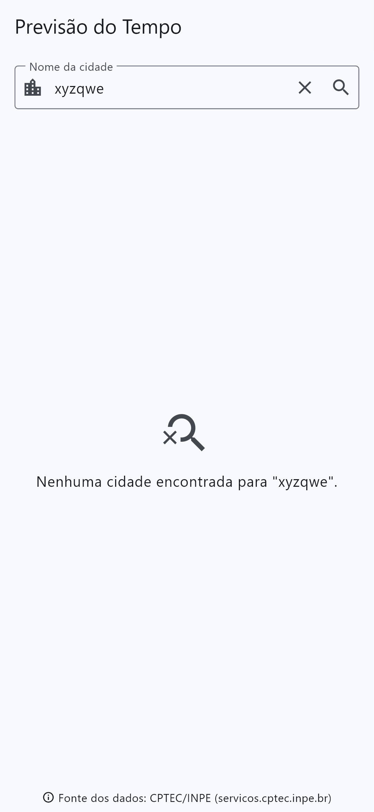
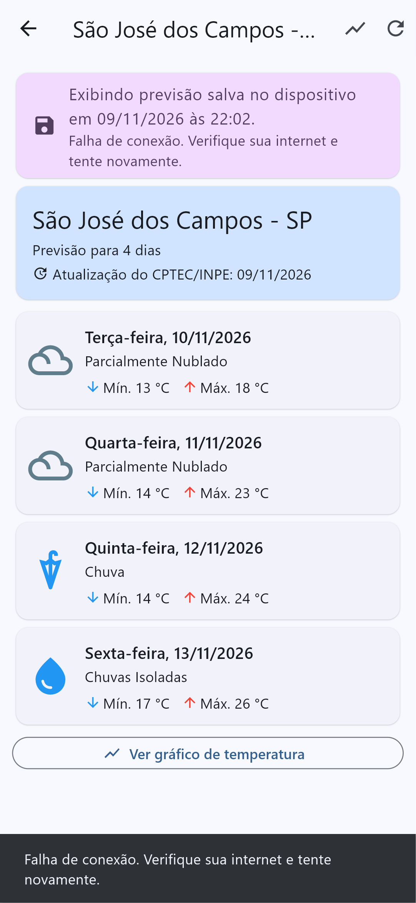
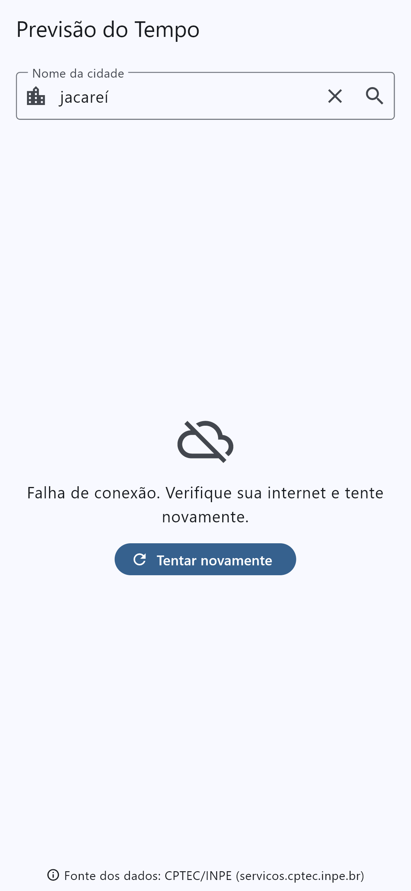

# Atividade 2 – Previsão do tempo

**Programação para Dispositivos Móveis I – Prof. Arley** · FATEC

Aplicativo em **Flutter** para consultar a previsão do tempo de cidades brasileiras usando os dados do **CPTEC/INPE** (serviço XML). Permite pesquisar cidades, ver a previsão para 4 dias e um gráfico de temperaturas.

> Fonte dos dados: **CPTEC/INPE** – <https://servicos.cptec.inpe.br/XML/>

## Funcionalidades implementadas

### 1. Pesquisa de cidades
- Campo para digitar o nome da cidade (aceita acentos, ex.: "Jacareí", "são josé").
- Consulta `listaCidades?city=<nome>` no CPTEC/INPE.
- Os resultados mostram **nome da cidade** e **UF** (e o código CPTEC); o usuário toca na localidade desejada.
- A previsão é consultada com o **código (`id`) devolvido pelo próprio serviço**.

### 2. Consulta da previsão do tempo
- Consulta `cidade/<código>/previsao.xml` (**previsão para 4 dias**) e exibe **todos os dias retornados**.
- Para cada dia:
  - **Data** da previsão (com o dia da semana);
  - Temperatura **mínima e máxima** em °C;
  - **Descrição** da condição do tempo — as siglas (`pn`, `c`, `ci`, `ps`...) são convertidas pela tabela oficial do CPTEC/INPE (40 siglas, em `lib/services/condicoes_tempo.dart`);
  - **Ícone** representativo da condição;
  - **Índice ultravioleta**, quando disponível (com a classificação Baixo/Moderado/Alto/Muito alto/Extremo). O CPTEC devolve `0.0` quando o índice não foi calculado, então nesse caso o IUV não é mostrado.
- Exibe a **data de atualização** informada pelo serviço (`<atualizacao>`).

### 3. Gráfico de temperaturas
- Tela com gráfico de linhas (biblioteca `fl_chart`) com as temperaturas **máxima** (vermelho) e **mínima** (azul) de cada dia, legenda, valores ao tocar nos pontos e tabela de valores abaixo.

### 4. Navegação entre telas
`Pesquisa de cidades` → `Previsão (4 dias)` → `Gráfico de temperaturas`, com `Navigator.push`/voltar.

### 5. Atualização e tratamento de erros
- Botão **Atualizar** na barra superior e "puxar para atualizar" na lista da previsão.
- **Indicador de carregamento** durante as consultas (circular na primeira carga, barra linear ao atualizar).
- Mensagem quando **nenhuma cidade é encontrada**.
- Tratamento de **falha de conexão**, **tempo esgotado**, **serviço indisponível** (HTTP ≠ 200) e **resposta inválida** (XML malformado ou inesperado), com botão "Tentar novamente".
- Mensagem quando **não há previsão disponível** (o CPTEC devolve campos `null` para códigos sem previsão).
- **Campos ausentes** (ou com o texto `null`, ou com valores inválidos) são tratados sem encerrar o app: aparecem como "--", "Data não informada" ou "Condição não informada".
- O **CPTEC/INPE é identificado como fonte dos dados** no rodapé de todas as telas.

## Estratégia de persistência local

Foi usada a biblioteca **`shared_preferences`** (armazenamento chave/valor nativo do dispositivo — `SharedPreferences` no Android, `NSUserDefaults` no iOS), com os objetos convertidos para **JSON**. A classe responsável é `lib/data/armazenamento_local.dart`.

| Chave | Conteúdo | Uso |
|---|---|---|
| `cidades_recentes` | Lista JSON das últimas **10** cidades consultadas (`id`, `nome`, `uf`), da mais recente para a mais antiga, sem repetição | Exibida na tela inicial como "Consultas recentes" para abrir a previsão sem pesquisar de novo. Cada item pode ser removido, ou a lista pode ser limpa. |
| `previsao_<código>` | Última previsão obtida com sucesso para a cidade (JSON com os 4 dias, data de atualização do CPTEC) e o **momento em que foi salva** | Ao abrir uma cidade, a previsão salva aparece **imediatamente** enquanto a nova consulta é feita. Se a consulta falhar (sem internet, serviço fora do ar), a previsão salva continua na tela com o aviso *"Exibindo previsão salva no dispositivo em dd/mm/aaaa às hh:mm"*. |

Dados salvos corrompidos são ignorados (o app não quebra). Só são salvas previsões com dados (respostas vazias não sobrescrevem a última previsão válida).

## Bibliotecas utilizadas

| Biblioteca | Para quê |
|---|---|
| [`http`](https://pub.dev/packages/http) | Requisições HTTP ao serviço do CPTEC/INPE |
| [`xml`](https://pub.dev/packages/xml) | Interpretação das respostas em XML |
| [`shared_preferences`](https://pub.dev/packages/shared_preferences) | Persistência local (cidades recentes e previsões salvas) |
| [`fl_chart`](https://pub.dev/packages/fl_chart) | Gráfico de temperaturas |
| `flutter_test`, `integration_test` (SDK) | Testes unitários, de widget e de integração |

As respostas do CPTEC vêm em **ISO-8859-1**; o app decodifica os bytes como latin1 (ou UTF-8 quando declarado no XML) para exibir os acentos corretamente.

## Como executar

Pré-requisitos: [Flutter](https://docs.flutter.dev/get-started/install) 3.x (testado com Flutter 3.47 / Dart 3.13) e um dispositivo/emulador Android, iOS ou Windows.

```bash
git clone https://github.com/teodoroooo/atividade2_previsao_tempo.git
cd atividade2_previsao_tempo
flutter pub get
flutter run
```

- Android: a permissão `INTERNET` já está declarada em `android/app/src/main/AndroidManifest.xml`.
- Windows: é necessário ativar o *Modo de Desenvolvedor* do Windows (exigência do Flutter para plugins).
- Web não é suportado: o serviço do CPTEC/INPE não envia cabeçalhos CORS, então o navegador bloqueia as requisições.

### Testes

```bash
# Testes unitários e de widget (com serviço HTTP simulado) + cobertura
flutter test --coverage

# Teste de integração com o serviço REAL do CPTEC/INPE (gera as capturas de tela)
flutter test integration_test -d windows --dart-define=SCREENSHOTS=%CD%/docs/screenshots
```

- **62 testes** cobrindo: parser XML (cidades, previsão, campos `null`/ausentes/inválidos, XML malformado), conversão das 40 siglas, serviço HTTP (URLs, codificação ISO-8859-1, HTTP 500/503, sem conexão, timeout, resposta inválida), persistência local e as telas (pesquisa, nenhuma cidade, carregamento, erros, previsão sem dados, atualização, previsão salva offline, gráfico, navegação).
- Cobertura de linhas de `lib/`: ~97%.

## Estrutura do projeto

```
lib/
├── main.dart                         # App e injeção das dependências
├── models/                           # Cidade, PrevisaoDia, PrevisaoCidade
├── services/
│   ├── cptec_service.dart            # Requisições HTTP + tratamento de erros
│   ├── cptec_parser.dart             # Leitura dos XMLs
│   ├── cptec_exception.dart          # Tipos de falha e mensagens
│   └── condicoes_tempo.dart          # Siglas -> descrição e ícone
├── data/armazenamento_local.dart     # Persistência (shared_preferences)
├── screens/                          # Pesquisa, Previsão, Gráfico
├── widgets/comuns.dart               # Fonte dos dados, mensagens de estado
└── utils/formatacao.dart             # Datas, temperaturas, IUV
test/                                 # Testes unitários e de widget
integration_test/                     # Teste com o serviço real + capturas
```

## Capturas de tela

Capturas geradas pelo teste de integração com dados reais do CPTEC/INPE (09/11/2026).

| Tela inicial | Pesquisa de cidades | Previsão para 4 dias |
|:---:|:---:|:---:|
|  |  |  |

| Gráfico de temperaturas | Consultas recentes (persistência) | Nenhuma cidade encontrada |
|:---:|:---:|:---:|
|  |  |  |

| Sem internet: previsão salva | Falha de conexão |
|:---:|:---:|
|  |  |

---

Aluno: Gabriel Reginaldo Teodoro dos Santos – 4º DSM
